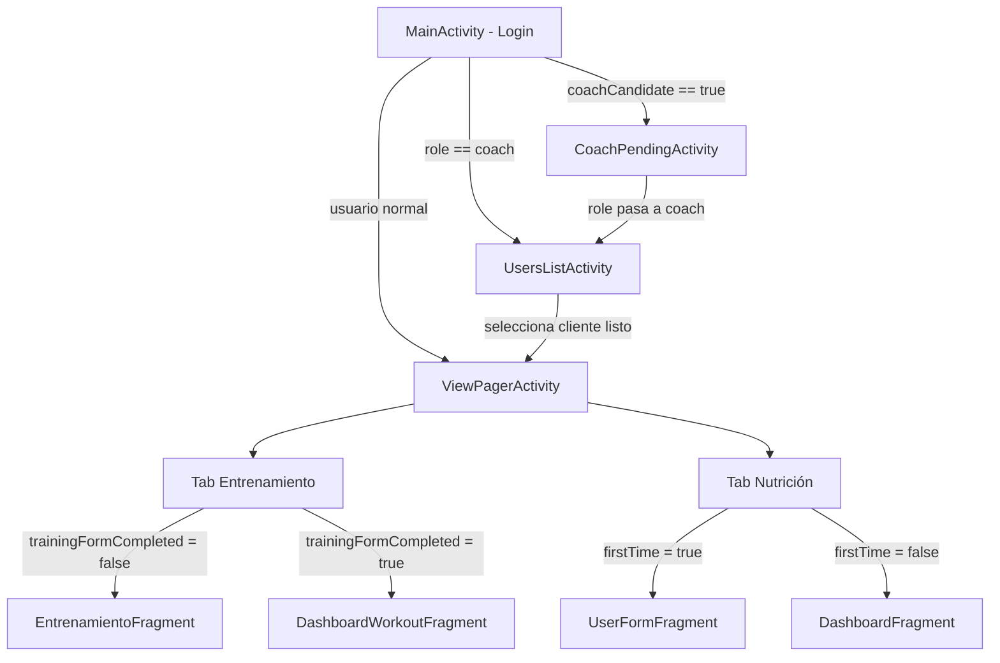

# Iron Progress

<p align="center">
  
</p>

**Iron Progress** es una aplicación Android nativa (Java) de **entrenamiento y nutrición** que combina un planificador de rutinas con progresión de cargas automática, un diario nutricional con búsqueda de alimentos/recetas online, seguimiento de peso y un modelo de roles **usuario / coach / administrador**. El backend es **Firebase** (Realtime Database + Auth), con integraciones externas a **Open Food Facts** y **Spoonacular**, escaneo de código de barras con **CameraX + ML Kit**, y gráficas con **MPAndroidChart**.

> Nombre interno del módulo Gradle: `Diets` (`settings.gradle.kts`) · `applicationId`: `com.example.diets`

---

## Tabla de contenidos

1. [Visión general](#visión-general)
2. [Funcionalidades principales](#funcionalidades-principales)
3. [Modelo de roles y navegación](#modelo-de-roles-y-navegación)
4. [Arquitectura y stack tecnológico](#arquitectura-y-stack-tecnológico)
5. [Estructura del proyecto](#estructura-del-proyecto)
6. [Modelo de datos](#modelo-de-datos)
7. [Integraciones externas](#integraciones-externas)
8. [El algoritmo de progresión dinámica](#el-algoritmo-de-progresión-dinámica)
9. [Capa de red](#capa-de-red)
10. [Testing](#testing)
11. [Permisos de la aplicación](#permisos-de-la-aplicación)
12. [Configuración y compilación](#configuración-y-compilación)
13. [Notas, deuda técnica y problemas conocidos](#notas-deuda-técnica-y-problemas-conocidos)

---

## Visión general

La app está pensada para dos tipos de usuario final:

- **Usuario normal**: completa un formulario inicial de entrenamiento y otro de nutrición, recibe un plan de entrenamiento (split de días según sus respuestas), registra sus series/repeticiones/peso en cada sesión, lleva un diario de comidas con macros, y hace seguimiento de su peso corporal con ajuste automático de calorías.
- **Coach**: es un rol elevado (solo puede existir **un coach a la vez** en el sistema, regla de negocio validada en el registro) que ve la lista de sus clientes y puede entrar en "modo coach" a la app de cualquiera de ellos para revisar o editar sus datos de entrenamiento/nutrición como si fuera él.

Además existe un panel de **administración** más simple y algo independiente del flujo anterior (`AdminActivity`, `UserListActivity`, `UserDetailsActivity`, `EditUserActivity`, `RegisterUserByAdminActivity`) para dar de alta/editar/consultar usuarios manualmente.

---

## Funcionalidades principales

### 🏋️ Entrenamiento
- Formulario inicial (`EntrenamientoFragment`) que recoge días/semana disponibles, exigencia física del trabajo, objetivo, experiencia y tiempo disponible.
- Generación de **splits de entrenamiento recomendados** (`ExerciseDistributionFragment`) a partir de plantillas guardadas en Firebase (`/exerciseDistributions`), filtradas por número de días.
- Selección de ejercicios concretos por día (`SelectExercisesFragment`, con diálogos de selección `ExerciseSelectionDialogFragment*`).
- Asignación de carga inicial, repeticiones máximas y nivel de familiaridad por ejercicio (`AssignLoadFragment` + `ExerciseDetailsLoadFragment`).
- Pantalla de sesión de entrenamiento activa (`TrainingDetailFragment`): cronómetro, registro de series (repeticiones/peso/RPE), reordenar ejercicios arrastrando, añadir ejercicios sobre la marcha, confirmaciones de borrado/series incompletas, y guardado en Firebase.
- **Progresión dinámica de cargas** automática entre sesiones (ver [sección dedicada](#el-algoritmo-de-progresión-dinámica)).
- Gráfica de progreso por ejercicio (`ExerciseDetailsDialogFragment`, vía MPAndroidChart) y galería de imágenes/carrusel por ejercicio (`ExerciseDetailsFragment`).
- Gestión de ejercicios personalizados creados por el usuario, guardados como JSON local por usuario (`CreatedExercisesFragment(Alt)` + `AddExerciseDialogFragment`).

### 🍎 Nutrición
- Diario de comidas por día (`DashboardFragment`) organizado en bloques (Desayuno, Almuerzo, Comida, Snack, Cena), con barras de progreso de calorías/proteína/carbohidratos/grasa frente a objetivos configurables.
- Editor de objetivos calóricos/macros con **rebalanceo automático** según el objetivo del usuario (volumen/definición/mantenimiento), con límites de seguridad (tope de +10 % por ajuste).
- Búsqueda de alimentos y recetas (`FoodSearchFragment`): texto libre o **escaneo de código de barras** (CameraX + ML Kit Barcode Scanning), con filtros rápidos (vegano, sin gluten, Nutri-Score, alto en proteína, bajo en grasa, etc.).
- Resultados combinados de **Open Food Facts** (productos empaquetados) y **Spoonacular** (recetas), con traducción automática de recetas del inglés al español vía **ML Kit Translate**.
- Alimentos/recetas favoritos persistidos localmente (`FavoritesFoodFragment`).
- Navegación de fechas en el diario (hasta 365 días hacia adelante) y limpieza automática de entradas antiguas.

### ⚖️ Seguimiento de peso
- Registro histórico de peso (`WeightFragment`) con gráfica de evolución (MPAndroidChart), añadir/editar/eliminar (swipe) registros.
- Estadísticas semanales (medias móviles de 7 días de peso y calorías, pendiente de regresión lineal).
- **Ajuste automático de calorías** (`ajustarCaloriasSegunMeta`): si la tendencia de peso no coincide con el objetivo del usuario durante 2 semanas seguidas, ajusta las calorías diarias en ±5 %, con un periodo de enfriamiento de 7 días entre ajustes.

### 👥 Coach / Administración
- Registro con solicitud de rol de coach (`RegisterActivity`), sujeta a la regla de "coach único" comprobada contra `/users` (`orderByChild("role").equalTo("coach")`).
- Pantalla de espera de aprobación (`CoachPendingActivity` / `CoachPendingFragment`), escuchando en tiempo real el cambio de `role` en Firebase.
- Lista de clientes del coach (`UsersListActivity`) con indicador de si cada cliente completó sus formularios de entrenamiento/nutrición, y acceso en "modo coach" (`coachMode=true`, `targetUid=<uid>`) a los datos del cliente.
- Panel de administración alternativo con listado de usuarios, alta manual (con foto y geolocalización) y edición/borrado (`AdminActivity`, `UserListActivity`, `UserDetailsActivity`, `EditUserActivity`, `RegisterUserByAdminActivity`).

---

## Modelo de roles y navegación



`ViewPagerActivity` es el hub central de la experiencia de usuario normal: aloja un `ViewPager2` de 2 pestañas (Entrenamiento / Nutrición) gestionado por `ViewPagerAdapter`, resuelve el UID activo (propio o de un cliente en modo coach) y expone helpers de navegación (`switchTo*Fragment`) usados por todo el árbol de fragments.

---

## Arquitectura y stack tecnológico

- **Lenguaje**: Java (con plugin de Kotlin configurado en Gradle, aunque no hay código Kotlin en `src/main`).
- **Patrón**: Activities + Fragments "clásico" de Android (sin arquitectura MVVM estricta ni Jetpack Compose); un único `ViewModel` (`SharedViewModel`) para compartir estado entre fragments concretos.
- **Backend / datos**: Firebase Realtime Database (fuente principal de datos), Firebase Authentication (email/contraseña).
- **UI**: AndroidX + Material Components, `ViewPager2`, `RecyclerView`, `ConstraintLayout`, `CardView`.
- **Imágenes**: Glide (carga remota) + imágenes en Base64 almacenadas directamente en Firebase para fotos de perfil/ejercicios.
- **Gráficas**: MPAndroidChart (peso, progreso de ejercicio).
- **Cámara / visión**: CameraX (preview + análisis de frames) y ML Kit Barcode Scanning (EAN-13/UPC-A).
- **Traducción**: ML Kit Translate (on-device, descarga de modelo restringida a Wi-Fi).
- **Red**: OkHttp (cliente singleton propio) + Gson para (de)serialización JSON.
- **Persistencia local**: `SharedPreferences` (favoritos, objetivos de macros, preferencias de progresión dinámica) y ficheros JSON internos por usuario (ejercicios personalizados).
- **Firma / build**: Gradle Kotlin DSL, Java 17, `compileSdk`/`targetSdk` 34, `minSdk` 24, *core library desugaring* habilitado.

### Dependencias clave (`app/build.gradle.kts`)

| Categoría | Librería |
|---|---|
| Red | OkHttp 5.3.0 (BOM) + logging-interceptor, Gson 2.8.8 |
| Firebase | firebase-bom, analytics, auth, database, storage, firestore, crashlytics-ndk |
| UI | appcompat, material, activity-ktx, constraintlayout, viewpager2, recyclerview, cardview |
| Imágenes | Glide 4.16.0 |
| Gráficas | MPAndroidChart v3.1.0 (JitPack) |
| Cámara | CameraX (core, camera2, lifecycle, view) 1.3.3 |
| ML | ML Kit Translate 17.0.1, ML Kit Barcode Scanning 17.2.0 |
| Auth social | play-services-auth 20.6.0 (Google Sign-In, declarado pero no implementado en el flujo actual) |
| Tests | JUnit 4.13.2, AndroidX Test JUnit, Espresso |

---

## Estructura del proyecto

```
IronProgress/
├── app/
│   ├── build.gradle.kts              # Configuración del módulo, firma de release, dependencias
│   ├── google-services.json          # Configuración del proyecto Firebase (no versionar credenciales)
│   ├── proguard-rules.pro            # Reglas ProGuard (plantilla, minifyEnabled = false en release)
│   └── src/
│       ├── main/
│       │   ├── AndroidManifest.xml
│       │   ├── java/com/example/diets/
│       │   │   ├── activitys/        # Activities + adapter de listas + ViewModel compartido
│       │   │   ├── adapters/         # RecyclerView/ViewPager/ListView adapters
│       │   │   ├── dialogs/          # DialogFragments (escáner de código de barras, recetas, etc.)
│       │   │   ├── fragments/        # Pantallas de entrenamiento, nutrición, peso, coach
│       │   │   ├── model/            # Modelos de dominio (Firebase POJOs + lógica de negocio)
│       │   │   ├── network/          # Cliente HTTP compartido + interceptor de métricas
│       │   │   ├── prefs/            # Preferencias (progresión dinámica) — versión "actual"
│       │   │   ├── selection/        # Interfaces de callback de selección de ejercicios
│       │   │   ├── Utils/            # Utilidades varias (red, preferencias — versión legacy)
│       │   │   └── viewmodel/        # ViewModel de detalle de entrenamiento
│       │   └── res/                  # Layouts, drawables, strings, temas, iconos
│       ├── androidTest/               # Test instrumentado de ejemplo (plantilla)
│       └── test/                      # Tests unitarios JVM + dobles de prueba (ver sección Testing)
├── gradle/                            # Wrapper y catálogo de versiones (libs.versions.toml)
├── build.gradle.kts / settings.gradle.kts / gradle.properties
├── gradlew / gradlew.bat
├── keystore.properties                # Credenciales de firma de release (NO versionado, ignorado por git)
└── logo.png
```

> **Nota:** en la raíz del repositorio existen también varios ficheros `activity_*.xml` y `splash_screen.xml` sueltos. Son copias antiguas/no utilizadas — el layout real que compila la app vive únicamente bajo `app/src/main/res/layout/`. Ver [Notas y deuda técnica](#notas-deuda-técnica-y-problemas-conocidos).

---

## Modelo de datos

### Estructura principal en Firebase Realtime Database

```
/users/{uid}
    firstName, lastName, email, role ("user" | "coach")
    age, weight, height, gender, activityLevel, goal
    caloriesToday, proteinToday, carbToday, fatToday
    firstTime, trainingFormCompleted, foodFormCompleted, coachCandidate
    profilePhoto (Base64) / profilePhotoUrl
    latitude, longitude
    userExercises/{key}         -> UserExercise (carga, series, RPE, historial)
    userMovementPatterns/{key}  -> UserMovementPattern

/weightRecords/{uid}/{recordId}   -> WeightRecord (peso, calorías, fecha)
/exercises/{id}                   -> Exercise (catálogo global de ejercicios)
/exerciseDistributions/{id}       -> ExerciseDistribution (plantillas de splits)
/exerciseImages/{name}            -> imágenes de respaldo por nombre de ejercicio
```

### Clases de modelo (`model/`)

| Clase | Propósito |
|---|---|
| `User` | Perfil completo del usuario; lógica de negocio de cálculo calórico (fórmula tipo Mifflin-St Jeor + factor de actividad + objetivo), macros, IMC, `isCutting()`/`isBulking()`. |
| `Exercise` | Ejercicio del catálogo: equipo, tipo (fuerza/hipertrofia), músculos trabajados, tipo de movimiento (multiarticular/aislado), imágenes, patrones de movimiento asociados. |
| `UserExercise` (extiende `Exercise`) | Instancia de un ejercicio asignado a un usuario: carga actual, repeticiones máximas, familiaridad, historial de series, sugerencias de progresión aplicadas. |
| `ExerciseSeries` | Una serie realizada: repeticiones, peso, RPE, si está completada, carga previa, fecha; con validación de rangos (reps 1–30, peso 0–500 kg, RPE 0–10). |
| `ExerciseDistribution` | Plantilla de split de entrenamiento (número de días, si es recomendado, distribución por días). |
| `TrainingDay` | Día de entrenamiento: patrones de movimiento y lista de `UserExercise`. |
| `MovementPattern` / `UserMovementPattern` | Patrón de movimiento (grupo de ejercicios sinérgicos) y su variante con ejercicios asignados al usuario. |
| `Muscle` | Valor simple id/nombre de músculo. |
| `WeightRecord` | Entrada de peso corporal con fecha y calorías asociadas. |
| `Alimento` / `Producto` | Producto alimenticio con macro y micronutrientes (calorías, proteína, carbohidratos, azúcares, grasas, grasas saturadas, fibra, sodio, calcio, hierro, vitamina C) — modelos equivalentes/duplicados. |
| `FoodItem` | Alimento o receta dentro de un bloque de comida: macros por 100 g y totales calculados según los gramos indicados. |
| `FoodBlock` | Bloque/comida del día (p. ej. "Desayuno") con su lista de `FoodItem`. |
| `Receta` | Receta compuesta localmente a partir de una lista de `Producto`, con cálculo de totales nutricionales. |
| `ProgresionDinamica` | Motor de progresión de cargas (ver [sección dedicada](#el-algoritmo-de-progresión-dinámica)). |
| `UserScope` | Estado global simple (`activeUid`/`coachMode`) para el modo coach. |

---

## Integraciones externas

| Servicio | Uso |
|---|---|
| **Open Food Facts** (`world.openfoodfacts.org`) | Búsqueda de productos por texto y por código de barras escaneado; fuente principal de datos nutricionales de alimentos empaquetados. |
| **Spoonacular** (`api.spoonacular.com`) | Búsqueda de recetas con información nutricional, ingredientes e instrucciones. |
| **ML Kit Translate** | Traducción on-device de recetas de Spoonacular (inglés → español). |
| **ML Kit Barcode Scanning + CameraX** | Escaneo de código de barras en vivo desde la cámara para buscar productos. |
| **Firebase Auth** | Registro/login con email y contraseña. |
| **Firebase Realtime Database** | Almacén de datos principal (usuarios, ejercicios, entrenamientos, peso). Persistencia local deshabilitada explícitamente. |
| **Firebase Firestore / Storage / Crashlytics / Analytics** | Dependencias declaradas en Gradle; uso muy limitado o no verificado en el código actual (ver deuda técnica). |

---

## El algoritmo de progresión dinámica

`model/ProgresionDinamica.java` es el motor "inteligente" del módulo de entrenamiento: decide cómo debe progresar la carga de un ejercicio de una sesión a otra sin intervención manual. Puntos clave:

- **Estimación de 1RM** combinando varias fórmulas clásicas (Epley, Brzycki, Lombardi, O'Conner).
- **Cálculo de RIR / repeticiones efectivas** a partir del RPE reportado en cada serie.
- **Periodización ondulante** para ejercicios multiarticulares: ciclo de RPE objetivo `{5, 7, 9, 6, 8, 10}` con reducción progresiva de repeticiones por bloque.
- **Progresión doble** (reps → peso) para ejercicios de aislamiento.
- **Seguimiento de tonelaje semanal** con detección automática de necesidad de *deload*.
- Estado del ciclo por ejercicio persistido en `SharedPreferences` (clave `estado_ciclo`), activable/desactivable de forma global o por ejercicio (ver `prefs/Prefs.java`).

---

## Capa de red

- `network/OkHttpSingleton.java`: `OkHttpClient` singleton (double-checked locking), con timeouts de conexión/lectura/llamada (15 s / 45 s / 50 s), `User-Agent` propio, reintentos automáticos con backoff exponencial (hasta 3 intentos) y el interceptor de métricas.
- `network/MetricsInterceptor.java`: identifica el destino de cada llamada (Open Food Facts / Spoonacular / otro), registra latencia, código HTTP, reintentos y tamaño de payload; **redacta la API key** en los logs de URL de Spoonacular.

---

## Testing

La suite de tests unitarios JVM vive en `app/src/test/java/com/example/diets/` y sigue una nomenclatura de casos de prueba con identificadores (`UT_VAL_001`, `UT_SEL_006`, etc.).

- **Estado actual**: la mayoría de clases de test (`AuthRulesUnitTests`, `MappingAndMediaUnitTests`, `NutritionUnitTests`, `SelectionUnitTests`, `TrainingUnitTests`, `UT_SEL_006_Test`) son **clases vacías** (sin métodos `@Test`) — su nombre indica el área que deberían cubrir (reglas de autenticación/coach único, mapeo Firebase y media en Base64, cálculo de macros, filtrado de selección de ejercicios, lógica de entrenamiento/progresión) pero aún no implementan aserciones.
- `UT_VAL_001_Test` sí contiene un test real, aunque de tipo *sanity check* (confirma que el runner de JUnit4 funciona).
- Paquete `testing/fakes/`: dobles de prueba ya preparados para desacoplar futuros tests de Firebase/red — `AuthProvider`/`FakeAuthProvider`, `OffClient`/`FakeOffClient`/`OffResponse` (simula respuestas de Open Food Facts), `RtdbGateway`/`FakeRtdbGateway` (simula reglas de seguridad: solo permite escrituras bajo `/users/{uid}` del propio usuario). Actualmente el código de producción **no usa estas abstracciones** — llama directamente a Firebase/OkHttp, por lo que los dobles no están conectados todavía a clases reales.
- `testutil/TestDoubles.java`: helpers de lógica pura replicando algoritmos de producción (normalización de nombres de músculo, cálculo de macros por porción, decodificación Base64, validación de ejercicios, validador de RPE) pensados para probar lógica aislada sin dependencias de Android/Firebase.
- `androidTest/`: contiene únicamente la plantilla por defecto de Android Studio (`ExampleInstrumentedTest`).

En resumen: existe una base de testing bien pensada (dobles, nomenclatura de casos) pero la cobertura real todavía es mínima.

---

## Permisos de la aplicación

Declarados en `AndroidManifest.xml`:

| Permiso | Motivo |
|---|---|
| `CAMERA` | Escaneo de código de barras y fotos de perfil/ejercicios. |
| `ACCESS_FINE_LOCATION` | Geolocalización al registrar usuarios (alta por admin/coach). |
| `INTERNET` / `ACCESS_NETWORK_STATE` | Firebase y llamadas a Open Food Facts/Spoonacular; detección del tipo de red. |
| `READ_EXTERNAL_STORAGE` | Selección de imágenes desde el dispositivo. |
| `GET_ACCOUNTS` | Soporte de inicio de sesión con cuentas de Google (dependencia declarada). |
| `WAKE_LOCK`, `RECEIVE_BOOT_COMPLETED` | Soporte de infraestructura Firebase (mensajería/servicios en segundo plano). |

También declara `<queries>` para Google Play Services / Play Store (requerido en Android 11+).

---

## Configuración y compilación

### Requisitos
- Android Studio (AGP 8.7.3) con SDK 34 instalado.
- JDK 17.
- Un proyecto de Firebase propio con Realtime Database y Authentication (email/contraseña) habilitados, y su `google-services.json` colocado en `app/`.

### Pasos
```bash
git clone <url-del-repositorio>
cd IronProgress
./gradlew assembleDebug     # build de depuración
./gradlew testDebugUnitTest # ejecutar tests unitarios JVM
```

### Firma de release
El build de `release` lee `keystore.properties` desde la raíz del proyecto (fichero **no versionado**, excluido por `.gitignore` junto con `*.jks`/`*.keystore`). Para generar un build de release es necesario crear ese fichero localmente con las propiedades `storeFile`, `storePassword`, `keyAlias` y `keyPassword` apuntando a un keystore propio.

---

## Notas, deuda técnica y problemas conocidos

Detectadas durante el análisis del código, útiles como hoja de ruta de mejoras:

- **API key de Spoonacular embebida en el código fuente** (`FoodSearchFragment`). Debería moverse a un mecanismo seguro (variables de entorno de build, `local.properties` no versionado, o un backend intermedio) en lugar de estar hardcodeada en el cliente.
- **Dos clases `Application` distintas**: `activitys.DietsApp` (la realmente usada en el manifest) y `activitys.DietsApplication` (no referenciada por ningún sitio) — código muerto a eliminar.
- **Dos implementaciones distintas de preferencias de "progresión dinámica"**: `Utils.Prefs` (legacy, ficheros de `SharedPreferences` inconsistentes) y `prefs.Prefs` (la que realmente usa `TrainingDetailFragment`). Conviene eliminar la versión legacy.
- **Modelos duplicados**: `Alimento` y `Producto` representan esencialmente lo mismo (producto alimenticio con macro/micronutrientes).
- **`minifyEnabled = false` en el build de release**: ProGuard/R8 no está activo, por lo que el APK de release no se ofusca ni se reduce de tamaño.
- **BOM de Firebase declarado dos veces** en `app/build.gradle.kts` (una vez con la versión 33.5.1 y otra vez con 34.4.0) — configuración redundante que debería consolidarse en una sola declaración.
- **Google Sign-In declarado pero no implementado**: la dependencia `play-services-auth` y el string `default_web_client_id` existen, pero no hay flujo de login social visible en el código actual; solo login por email/contraseña.
- **Ficheros de layout sueltos en la raíz del repositorio** (`activity_*.xml`, `splash_screen.xml`): no forman parte del árbol de recursos real (`app/src/main/res/layout/`) y parecen copias antiguas sin usar; candidatos a limpieza.
- **`testing/fakes/` sin conectar**: los dobles de prueba (Auth/OFF/RTDB) están definidos pero el código de producción no pasa por esas interfaces, por lo que actualmente no aportan cobertura real — sería necesario introducir inyección de dependencias para aprovecharlos.
- **Firestore/Storage declarados pero apenas usados**: dependencias presentes en Gradle sin una implementación clara y consistente en el código fuente revisado.
